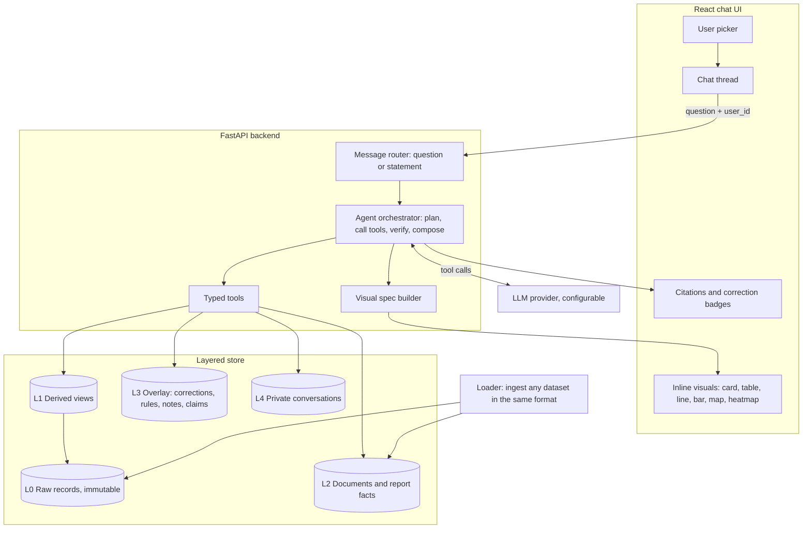
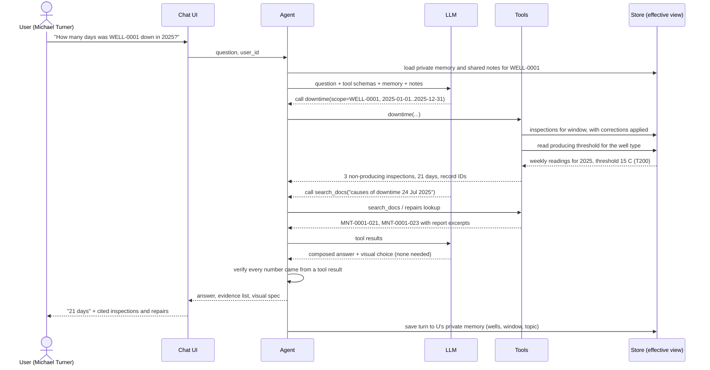
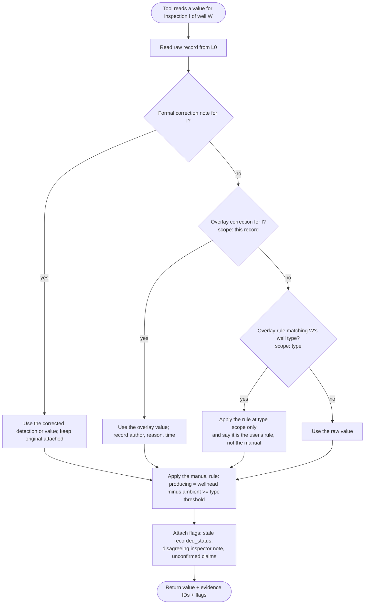
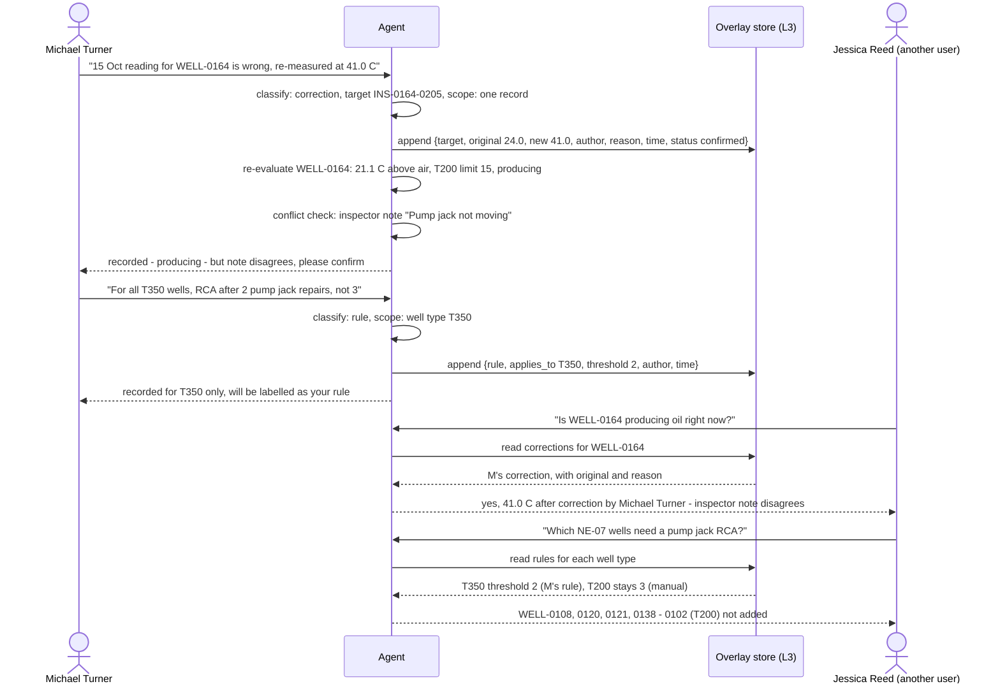
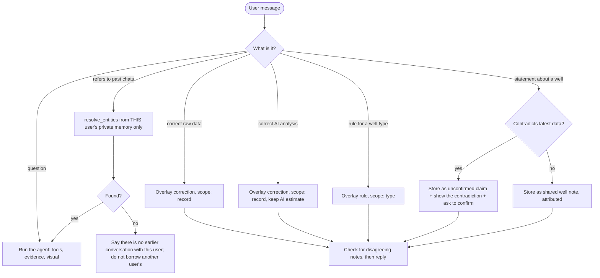
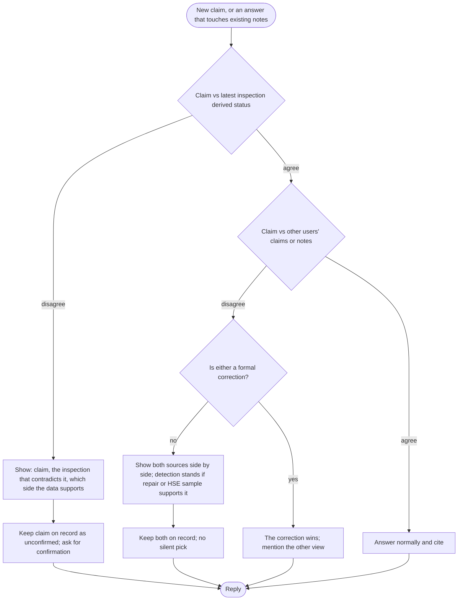
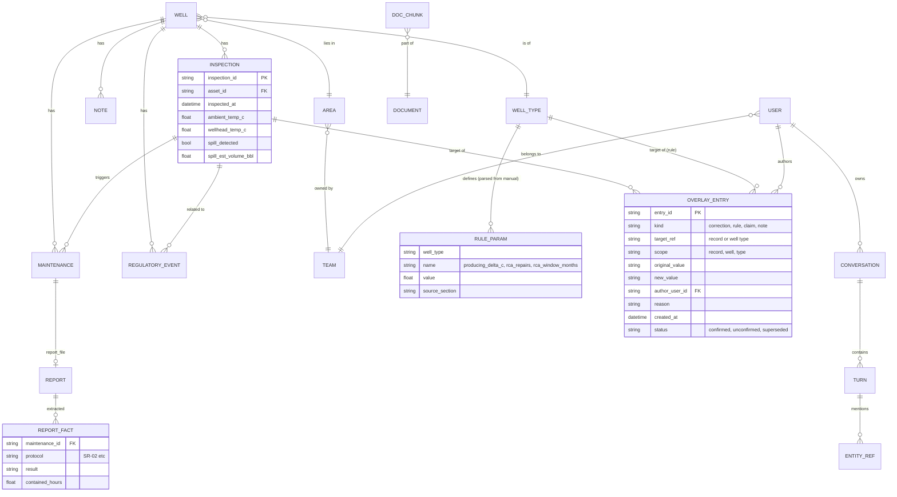
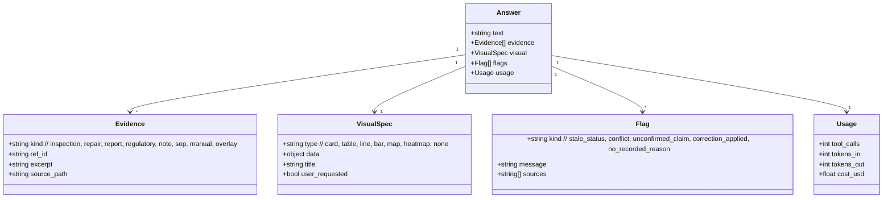

# Wellspring: flows and diagrams

Diagrams are [Mermaid](https://mermaid.js.org/), which GitHub renders in the browser. Each
one has a "verify" note listing what to check against the problem statement and example
questions (Q1-Q18). If a diagram looks wrong to you, the design is wrong, so say so before
we build it.

| # | Diagram | Answers |
|---|---|---|
| 1 | System components | What are the parts and who talks to whom? |
| 2 | Question to answer, end to end | What happens when someone asks Q5? |
| 3 | Effective truth resolution | How do raw data, corrections and notes combine? |
| 4 | Feedback and scope | How does a correction or a rule reach other users, and only the right wells? |
| 5 | Routing what a user says | Is it a question, a fact, a correction, a rule or a claim? |
| 6 | Conflict handling | How do we avoid silently picking a side (Q17, Q18)? |
| 7 | Data model | What is stored, and what is only derived? |
| 8 | Response contract | What does every answer contain? |

---

## 1. System components

**Verify:** the LLM never touches storage directly, only through tools. Private data (L4) is
reachable only with the caller's `user_id`. A new dataset only needs the loader to run.

---

## 2. Question to answer, end to end

Example: _"How many days was WELL-0001 down in 2025?"_ (Q5, expected 21 days).

**Verify:** the 21 comes from the `downtime` tool, not from the model. The 24 Jul reading
(51.6 C wellhead, 43.1 C air) is judged on the difference, not the absolute value. The turn is
saved privately so Q11-style follow-ups work.

---

## 3. Effective truth resolution

How any tool decides what is "true" for a record. Original data is never changed.

**Verify:** a plain note that disagrees (Q18) does not count as a correction, so the detection
stands and the disagreement is shown instead. A correction beats raw data (Q4, Q12). Unconfirmed
user claims never change the value, only add a flag (Q17).

---

## 4. Feedback and scope

Q12 (raw reading corrected), Q13 (AI estimate corrected) and Q14 (rule for a well type), then
a different user asking later.

**Verify:** the correction is global to all users but narrow in scope. The T350 rule never touches
WELL-0102 (T200). The original value is retained and shown. Every overlay entry has an author and reason.

---

## 5. Routing what a user says

Not every message is a question. This decides where it goes.

**Verify:** the routing is the riskiest LLM step, so it gets its own tests (Q11, Q12, Q13, Q14, Q16,
Q17). Shared knowledge versus private memory is decided here, and private is enforced in code.

---

## 6. Conflict handling

Q17 (user claims vs data) and Q18 (two notes disagree).

**Verify:** Q17 Tyler Hughes ("running fine") gets told the 15 Oct inspection shows 0.4 C above air and that it matches Michael Turner's
note, not his claim. Q18 answers "yes" but shows Ryan Brooks's and Chris Dalton's notes.

---

## 7. Data model

**Verify:** "producing" and "downtime" are views over INSPECTION plus RULE_PARAM, never stored columns.
OVERLAY_ENTRY is the only table users can write into besides CONVERSATION. Raw tables are read-only.

---

## 8. Response contract

Every answer has the same shape, so the UI and the tests can both rely on it.

**Verify:** "cites the records and documents it used" is enforced structurally (no evidence, no numeric
claim), and `Usage` gives the cost numbers the write-up needs.

---

## How to use this to verify the design

1. Pick three questions, for example Q5, Q12 and Q17, and trace each through diagrams 2, 4 and 6.
2. Look for any step where the LLM, not a tool, decides a number or a scope. That is a risk.
3. Look for any path where one user's private data can reach another. There should be none.
4. Check that no diagram mentions a specific well or the sample's numbers except as an example.
